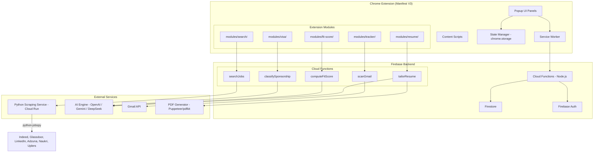

# Design Document: JobPilot Enhanced Features

## Overview

This design extends JobPilot AI from a LinkedIn-only auto-applier into a full-stack job search platform. Five new subsystems are introduced:

1. **Multi-Board Job Search** — A Python scraping service (python-jobspy) orchestrated via Firebase Cloud Functions, delivering normalized job listings from 6+ boards.
2. **AI-Powered Resume Tailoring** — Server-side LLM rewriting of resume bullets matched to each job description, with PDF generation.
3. **Job Fit Scoring** — AI-computed 0–100 scores comparing job descriptions against User_Profile dimensions.
4. **Application Tracking via Gmail** — OAuth 2.0 Gmail integration with periodic inbox scanning for interview/rejection/offer emails.
5. **Visa Sponsorship Detection** — Hybrid keyword + AI classification of job descriptions into sponsorship availability categories.

The architecture adds a Python microservice (Cloud Run) callable from Firebase Functions, new Firestore collections, and new extension modules — all integrated into the existing Manifest V3 Chrome Extension with vanilla JS (no build step).

## Architecture

### High-Level System Diagram



### Communication Flow

1. **Extension → Backend**: REST calls to Firebase Functions HTTPS endpoints with Firebase Auth Bearer tokens.
2. **Backend → Python Service**: Internal HTTP call from Cloud Function to Cloud Run service (authenticated via service account).
3. **Backend → AI Engine**: Server-side API calls using stored API keys (from Firebase config/secrets).
4. **Backend → Gmail API**: OAuth 2.0 access tokens stored per-user in Firestore, refreshed server-side.

### Deployment Model

| Component | Platform | Runtime |
|-----------|----------|---------|
| Chrome Extension | Chrome Web Store | MV3, vanilla JS |
| Cloud Functions | Firebase Functions v2 | Node.js 20 |
| Python Scraper | Cloud Run | Python 3.11, python-jobspy |
| Firestore | Firebase | NoSQL document DB |
| PDF Generation | Within Cloud Functions | puppeteer-core / pdfkit |

## Components and Interfaces

### Extension-Side Components

#### 1. `modules/search/search-service.js`
Handles multi-board job search requests and result caching.

```javascript
/**
 * Initiate a multi-board job search.
 * @param {Object} params
 * @param {string} params.query - Search query (2-200 chars)
 * @param {string[]} params.boards - Selected boards (min 1)
 * @param {string} [params.location] - Optional location filter
 * @param {string} [params.jobType] - full-time|part-time|contract|internship
 * @param {number} [params.page] - Page number (default 1)
 * @returns {Promise<{jobs: JobRecord[], total: number, failedBoards: FailedBoard[]}>}
 */
async function searchJobs(params) {}

/**
 * Validate search input before sending to backend.
 * @param {string} query
 * @param {string[]} boards
 * @returns {{valid: boolean, error?: string}}
 */
function validateSearchInput(query, boards) {}

/**
 * Cache search results in chrome.storage.local.
 * @param {string} searchId - Hash of query params
 * @param {JobRecord[]} jobs
 */
async function cacheSearchResults(searchId, jobs) {}
```

#### 2. `modules/resume/resume-service.js`
Manages resume upload, tailoring requests, and preview rendering.

```javascript
/**
 * Upload base resume (PDF/DOCX, max 5MB).
 * @param {File} file - The resume file
 * @returns {Promise<{success: boolean, error?: string}>}
 */
async function uploadBaseResume(file) {}

/**
 * Request AI-tailored resume for a specific job.
 * @param {string} jobId - The Job_Record ID
 * @returns {Promise<{pdfUrl: string, previewUrl: string}>}
 */
async function tailorResumeForJob(jobId) {}

/**
 * Check if a base resume exists in Resume_Store.
 * @returns {Promise<boolean>}
 */
async function hasBaseResume() {}
```

#### 3. `modules/fit-score/fit-score-service.js`
Retrieves and manages job fit scores.

```javascript
/**
 * Get fit score for a job. Returns cached if available.
 * @param {string} jobId
 * @returns {Promise<{score: number, explanation: string, excludedDimensions?: string[]}>}
 */
async function getFitScore(jobId) {}

/**
 * Trigger batch recompute of scores after profile update.
 * @returns {Promise<void>}
 */
async function recomputeAllScores() {}

/**
 * Get/set minimum score threshold from chrome.storage.
 * @param {number} [threshold] - If provided, sets the value
 * @returns {Promise<number>}
 */
async function fitScoreThreshold(threshold) {}
```

#### 4. `modules/tracker/tracker-service.js`
Gmail OAuth and application status tracking.

```javascript
/**
 * Initiate Gmail OAuth flow using chrome.identity.
 * @returns {Promise<{success: boolean, error?: string}>}
 */
async function connectGmail() {}

/**
 * Disconnect Gmail (revoke token).
 * @returns {Promise<void>}
 */
async function disconnectGmail() {}

/**
 * Trigger a manual scan of Gmail inbox.
 * @returns {Promise<TrackerEntry[]>}
 */
async function scanGmailNow() {}

/**
 * Get all tracked application statuses.
 * @returns {Promise<TrackerEntry[]>}
 */
async function getTrackedApplications() {}

/**
 * Manually correct or dismiss a tracker entry.
 * @param {string} entryId
 * @param {Object} correction - {status?: string, dismissed?: boolean}
 */
async function correctTrackerEntry(entryId, correction) {}
```

#### 5. `modules/visa/visa-service.js`
Retrieves and displays visa sponsorship classification.

```javascript
/**
 * Get sponsorship status for a job.
 * @param {string} jobId
 * @returns {Promise<{status: 'available'|'unlikely'|'unknown', confidence: 'full'|'reduced'}>}
 */
async function getSponsorshipStatus(jobId) {}

/**
 * Filter jobs by sponsorship status.
 * @param {JobRecord[]} jobs
 * @param {string[]} statuses - Filter values
 * @returns {JobRecord[]}
 */
function filterBySponsorshipStatus(jobs, statuses) {}
```

### Backend Cloud Functions

#### API Endpoint Design

All new endpoints follow the response contract:

```javascript
// Success
{ ok: true, data: {...}, meta: { requestId: "req_abc123" } }

// Error
{ ok: false, error: { code: "INVALID_REQUEST", message: "..." }, meta: { requestId: "req_abc123" } }
```

#### Function Signatures

```javascript
// functions/search.js
/**
 * POST /searchJobs
 * Body: { query, boards[], location?, jobType?, datePosted?, page? }
 * Auth: Bearer token required
 * Timeout: 60s (allows 30s per-board + processing)
 */
exports.searchJobs = functions.https.onRequest(async (req, res) => {});

// functions/resume.js
/**
 * POST /tailorResume
 * Body: { jobId }
 * Auth: Bearer token required
 * Timeout: 30s
 * Returns: { pdfUrl, previewUrl }
 */
exports.tailorResume = functions.https.onRequest(async (req, res) => {});

/**
 * POST /uploadResume
 * Body: multipart/form-data with file field
 * Auth: Bearer token required
 * Max size: 5MB
 */
exports.uploadResume = functions.https.onRequest(async (req, res) => {});

// functions/scoring.js
/**
 * POST /computeFitScore
 * Body: { jobId } or { jobIds: string[] }
 * Auth: Bearer token required
 * Timeout: 10s per job
 */
exports.computeFitScore = functions.https.onRequest(async (req, res) => {});

/**
 * POST /recomputeScores
 * Body: {} (uses authenticated user's cached jobs)
 * Auth: Bearer token required
 * Timeout: 60s
 */
exports.recomputeScores = functions.https.onRequest(async (req, res) => {});

// functions/tracker.js
/**
 * POST /scanGmail
 * Body: {} (uses stored OAuth token)
 * Auth: Bearer token required
 * Timeout: 30s
 */
exports.scanGmail = functions.https.onRequest(async (req, res) => {});

// functions/visa.js
/**
 * POST /classifySponsorship
 * Body: { jobId } or { jobIds: string[] }
 * Auth: Bearer token required
 * Timeout: 5s per job
 */
exports.classifySponsorship = functions.https.onRequest(async (req, res) => {});
```

### Python Scraping Service (Cloud Run)

```python
# scraper/main.py - Flask API for python-jobspy

@app.route('/scrape', methods=['POST'])
def scrape_jobs():
    """
    Request Body:
    {
        "query": "Backend Developer",
        "boards": ["linkedin", "indeed", "glassdoor", "naukri", "uplers", "adzuna"],
        "location": "India",
        "job_type": "full-time",
        "results_wanted": 100,
        "hours_old": 168  # 7 days
    }
    
    Response:
    {
        "jobs": [NormalizedJob],
        "failed_boards": [{"board": "glassdoor", "error": "timeout"}],
        "metadata": {"total": 85, "boards_succeeded": 5}
    }
    """
    pass
```

## Data Models

### Firestore Collections

#### `users/{userId}` (existing, extended)
```
{
  plan: "free" | "pro",
  planExpiresAt: Timestamp,
  email: string,
  name: string,
  // NEW fields:
  gmailConnected: boolean,
  gmailTokenRef: string,  // reference to tokens subcollection
  profileVersion: number, // incremented on profile update (triggers score recompute)
}
```

#### `users/{userId}/settings/profile` (existing, extended)
```
{
  firstName: string,
  lastName: string,
  // ... existing fields ...
  // NEW: used for fit scoring
  skills: string[],
  educationLevel: string,
  preferredLocations: string[],
  salaryMin: number,
  salaryMax: number,
  salaryCurrency: string,
}
```

#### `users/{userId}/resumes/{resumeId}` (NEW)
```
{
  id: string,
  type: "base" | "tailored",
  filename: string,
  mimeType: "application/pdf" | "application/vnd.openxmlformats-officedocument.wordprocessingml.document",
  sizeBytes: number,
  parsedContent: string,   // extracted text
  storageUrl: string,      // Cloud Storage path
  jobId: string | null,    // null for base, jobId for tailored
  createdAt: Timestamp,
}
```

#### `users/{userId}/jobs/{jobId}` (NEW - Job_Record)
```
{
  id: string,               // deterministic hash: sha256(title+company+location)
  title: string,
  company: string,
  location: string,
  description: string,
  salary: string | null,
  url: string,
  sourceBoard: "linkedin" | "indeed" | "glassdoor" | "naukri" | "uplers" | "adzuna",
  postedDate: Timestamp | null,
  
  // Enrichment fields (populated async)
  fitScore: number | null,         // 0-100
  fitExplanation: string | null,
  fitExcludedDimensions: string[],
  sponsorship: "available" | "unlikely" | "unknown" | null,
  sponsorshipConfidence: "full" | "reduced",
  
  // Metadata
  searchId: string,        // which search produced this
  retrievedAt: Timestamp,
  deduplicatedFrom: string[],  // source URLs merged into this record
}
```

#### `users/{userId}/tracker/{entryId}` (NEW - Application Tracker)
```
{
  id: string,
  company: string,          // extracted or "Unknown Company"
  status: "interview" | "rejection" | "offer" | "unknown",
  emailSubject: string,
  emailDate: Timestamp,
  emailSnippet: string,     // first 200 chars
  dismissed: boolean,
  manualCorrection: string | null,
  detectedAt: Timestamp,
}
```

#### `users/{userId}/tokens/gmail` (NEW - Gmail OAuth tokens)
```
{
  accessToken: string,      // encrypted at rest
  refreshToken: string,     // encrypted at rest
  expiresAt: Timestamp,
  scopes: string[],
  connectedAt: Timestamp,
  lastScanAt: Timestamp | null,
}
```

### Chrome Storage Schema (`chrome.storage.local`)

```javascript
{
  // Existing keys preserved...
  
  // NEW: Multi-board search
  "searchPrefs_boards": ["linkedin", "indeed", "glassdoor"],
  "searchPrefs_lastQuery": "Backend Developer",
  "searchCache_{searchId}": { jobs: [...], timestamp: number },
  
  // NEW: Fit score
  "fitScoreThreshold": 0,          // 0-100, default 0
  "fitScoreCache_{jobId}": { score: number, explanation: string, ts: number },
  
  // NEW: Resume
  "hasBaseResume": true,
  "baseResumeFilename": "resume.pdf",
  
  // NEW: Tracker
  "gmailConnected": false,
  "trackerEntries": [...],          // local cache of tracker entries
  "trackerLastScan": 1700000000,    // epoch ms
  
  // NEW: Visa filter
  "visaFilterStatuses": ["available", "unknown"],  // active filter selection
}
```

### Type Definitions (JSDoc for vanilla JS)

```javascript
/**
 * @typedef {Object} JobRecord
 * @property {string} id
 * @property {string} title
 * @property {string} company
 * @property {string} location
 * @property {string} description
 * @property {string|null} salary
 * @property {string} url
 * @property {string} sourceBoard
 * @property {string|null} postedDate - ISO date string
 * @property {number|null} fitScore
 * @property {string|null} fitExplanation
 * @property {string} sponsorship - "available"|"unlikely"|"unknown"
 * @property {string} sponsorshipConfidence - "full"|"reduced"
 */

/**
 * @typedef {Object} FailedBoard
 * @property {string} board
 * @property {string} error
 */

/**
 * @typedef {Object} TrackerEntry
 * @property {string} id
 * @property {string} company
 * @property {string} status - "interview"|"rejection"|"offer"|"unknown"
 * @property {string} emailSubject
 * @property {string} emailDate - ISO date string
 * @property {boolean} dismissed
 * @property {string|null} manualCorrection
 */

/**
 * @typedef {Object} SponsorshipResult
 * @property {string} status - "available"|"unlikely"|"unknown"
 * @property {string} confidence - "full"|"reduced"
 */
```


## Correctness Properties

*A property is a characteristic or behavior that should hold true across all valid executions of a system — essentially, a formal statement about what the system should do. Properties serve as the bridge between human-readable specifications and machine-verifiable correctness guarantees.*

### Property 1: Normalization Completeness

*For any* raw job listing returned from any supported board (with any combination of populated and missing fields), the normalization function SHALL produce a Job_Record containing non-null values for: `id`, `title`, `company`, `location`, `url`, and `sourceBoard`. Optional fields (`salary`, `postedDate`, `description`) may be null but must be present as keys.

**Validates: Requirements 1.3**

### Property 2: Partial Failure Resilience

*For any* set of boards where a non-empty subset fails (timeout or error), the search response SHALL contain results from all successful boards AND a `failedBoards` array identifying each failed board with its failure reason. The count of results plus the count of failed boards must account for all requested boards.

**Validates: Requirements 1.4**

### Property 3: Job Filter Correctness

*For any* list of Job_Records and *any* combination of filter criteria (source board, location, job type, date posted, fit score threshold, and sponsorship status), every job in the filtered output SHALL satisfy ALL active filter criteria simultaneously, and no job satisfying all criteria SHALL be excluded from the output.

**Validates: Requirements 1.6, 3.6, 5.8**

### Property 4: Deduplication Correctness

*For any* set of Job_Records, after deduplication via case-insensitive matching on (title, company, location), the output SHALL contain no two records with the same normalized key. For each group of duplicates, the retained record SHALL be the one with the highest number of non-null fields (most complete data).

**Validates: Requirements 1.7**

### Property 5: Search Preferences Round-Trip

*For any* valid search configuration (board selection of 1+ boards, query of 2-200 characters), persisting the preferences to chrome.storage.local and then reading them back SHALL yield values equal to the original configuration.

**Validates: Requirements 1.8**

### Property 6: Search Input Validation

*For any* search query of length < 2 or > 200 characters, OR an empty board selection, the validation function SHALL return `{valid: false}` with a descriptive error message. *For any* query of length 2-200 with at least one board selected, validation SHALL return `{valid: true}`.

**Validates: Requirements 1.9**

### Property 7: Resume File Validation

*For any* file upload attempt, IF the file exceeds 5 MB in size OR the MIME type is not `application/pdf` or `application/vnd.openxmlformats-officedocument.wordprocessingml.document`, THEN the validator SHALL reject with an appropriate error message. *For any* file within 5 MB and with a valid MIME type, the validator SHALL accept.

**Validates: Requirements 2.7**

### Property 8: Fit Score Range Constraint

*For any* raw score value returned by the AI_Engine (including non-integers, values outside 0-100, or invalid types), the score normalization function SHALL produce an integer in the inclusive range [0, 100] by clamping and rounding.

**Validates: Requirements 3.2**

### Property 9: Sort by Fit Score Correctness

*For any* list of Job_Records with fit scores, sorting by Fit_Score in descending order SHALL produce a list where each job's score is ≥ the score of the job following it.

**Validates: Requirements 3.5**

### Property 10: Partial Scoring with Excluded Dimensions

*For any* User_Profile missing one or more scoring dimensions (skills, experience, education, location, salary preference), the scoring function SHALL still produce a valid Fit_Score in [0, 100] AND the response SHALL list exactly the missing dimensions in `excludedDimensions`.

**Validates: Requirements 3.10**

### Property 11: Email Classification and Extraction

*For any* email containing recognizable application-related patterns (interview invitation keywords, rejection language, or offer letter phrases), the classifier SHALL identify it as application-related, and the extractor SHALL produce a TrackerEntry with a non-empty `status` field and a valid `emailDate`. If the company name is extractable, `company` SHALL not equal "Unknown Company".

**Validates: Requirements 4.3, 4.4**

### Property 12: Tracker Correction Persistence

*For any* TrackerEntry and *any* valid correction (status change or dismissal), applying the correction SHALL update the entry's fields accordingly: a status correction updates `manualCorrection` and `status`; a dismissal sets `dismissed: true`. The original `emailDate` and `emailSubject` SHALL remain unchanged.

**Validates: Requirements 4.7**

### Property 13: 30-Day Email Date Filter

*For any* set of emails with varying received dates, the scanner SHALL process ONLY emails with a received date within 30 days of the current date. Emails older than 30 days SHALL be excluded from processing regardless of their content.

**Validates: Requirements 4.8**

### Property 14: Sponsorship Classification Priority

*For any* job description text:
- If it contains one or more positive indicators (visa sponsorship, H-1B, work permit assistance, J-1 sponsorship, employer-sponsored work visa), the classification SHALL be "available" regardless of any negative indicators present.
- If it contains negative indicators but NO positive indicators, the classification SHALL be "unlikely".
- If it contains NO visa-related language at all, the classification SHALL be "unknown".

**Validates: Requirements 5.2, 5.3, 5.4, 5.5**

### Property 15: AI Fallback Confidence Indicator

*For any* sponsorship classification performed when the AI_Engine is unavailable, the result SHALL include `confidence: "reduced"`. When the AI_Engine IS available, the result SHALL include `confidence: "full"` regardless of classification ambiguity.

**Validates: Requirements 5.10, 5.11**

## Error Handling

### Error Categories and Responses

| Error Category | HTTP Code | Error Code | User-Facing Message |
|---|---|---|---|
| Invalid search input | 400 | INVALID_REQUEST | "Please enter a search query (2-200 characters) and select at least one job board." |
| Auth token expired | 401 | UNAUTHORIZED | "Session expired. Please sign in again." |
| Plan limit exceeded | 403 | FORBIDDEN | "This feature requires a Pro plan." |
| Job not found | 404 | NOT_FOUND | "Job listing no longer available." |
| Scraping timeout | 408 | REQUEST_TIMEOUT | "Some boards took too long to respond." |
| File too large | 422 | UNPROCESSABLE_ENTITY | "Resume must be under 5 MB. Your file is {size} MB." |
| AI engine failure | 502 | UPSTREAM_ERROR | "AI service temporarily unavailable. Please retry." |
| Scraping service down | 503 | SERVICE_UNAVAILABLE | "Job search service is temporarily down." |

### Extension-Side Error Handling Strategy

```javascript
/**
 * Centralized API call wrapper with error handling.
 * @param {string} endpoint - Cloud Function name
 * @param {Object} body - Request payload
 * @returns {Promise<Object>} - Response data
 * @throws {ApiError} - Structured error with code, message
 */
async function callBackend(endpoint, body) {
  const token = await getAuthToken();
  if (!token) throw new ApiError('UNAUTHORIZED', 'Not signed in');

  const requestId = generateRequestId();
  
  try {
    const response = await fetch(
      `https://us-central1-linkedin-jobcopilot.cloudfunctions.net/${endpoint}`,
      {
        method: 'POST',
        headers: {
          'Content-Type': 'application/json',
          'Authorization': `Bearer ${token}`,
          'x-request-id': requestId,
        },
        body: JSON.stringify(body),
      }
    );

    const result = await response.json();
    
    if (!result.ok) {
      throw new ApiError(result.error.code, result.error.message, result.meta?.requestId);
    }

    return result.data;
  } catch (err) {
    if (err instanceof ApiError) throw err;
    throw new ApiError('NETWORK_ERROR', 'Unable to reach server. Check your connection.', requestId);
  }
}
```

### Retry Strategy

| Operation | Max Retries | Backoff | Conditions |
|-----------|-------------|---------|------------|
| Job search | 1 | 5s | Only on 503/timeout |
| Resume tailoring | 2 | 3s, 6s | On 502/503 |
| Fit score compute | 1 | 3s | On 502 |
| Gmail scan | 0 | — | No retry (runs on schedule) |
| Sponsorship classify | 1 | 2s | On 502 (falls back to keyword-only) |

### Graceful Degradation

1. **Scraping service down**: Show cached results if available, display banner "Live search unavailable. Showing cached results from {date}."
2. **AI engine down**: Fit scores show "unavailable" badge; sponsorship falls back to keyword-only with "reduced confidence" indicator; resume tailoring shows retry button.
3. **Gmail token expired**: Badge on extension icon; features requiring Gmail show "Reconnect Gmail" prompt.
4. **Partial board failures**: Show results from successful boards; list failed boards with retry link per board.

## Testing Strategy

### Property-Based Testing

**Library**: [fast-check](https://github.com/dubzzz/fast-check) (JavaScript PBT library, compatible with Jest)

**Configuration**: Each property test runs minimum 100 iterations.

**Tag format**: `Feature: jobpilot-enhanced-features, Property {number}: {property_text}`

Properties to implement as PBT:
1. Normalization completeness (Property 1)
2. Partial failure resilience (Property 2)
3. Job filter correctness (Property 3)
4. Deduplication correctness (Property 4)
5. Search preferences round-trip (Property 5)
6. Search input validation (Property 6)
7. Resume file validation (Property 7)
8. Fit score range constraint (Property 8)
9. Sort by fit score correctness (Property 9)
10. Partial scoring with excluded dimensions (Property 10)
11. Email classification and extraction (Property 11)
12. Tracker correction persistence (Property 12)
13. 30-day email date filter (Property 13)
14. Sponsorship classification priority (Property 14)
15. AI fallback confidence indicator (Property 15)

### Unit Tests (Example-Based)

- UI state transitions (loading/success/error) for each feature panel
- OAuth flow initiation with correct scopes
- Token storage after successful Gmail connect
- Pagination rendering for 0, 50, 100, 150 results
- Prompt construction for fit scoring (verifies all 5 dimensions included)

### Integration Tests

- End-to-end search: Extension → Cloud Function → Python scraper → response
- Resume tailoring pipeline: upload → AI rewrite → PDF generation → download
- Gmail scan: OAuth → inbox fetch → classification → Firestore write
- Payment + plan gate: Pro feature returns 403 on free plan

### Test File Structure

```
tests/
├── properties/
│   ├── normalization.property.test.js
│   ├── deduplication.property.test.js
│   ├── filter.property.test.js
│   ├── validation.property.test.js
│   ├── scoring.property.test.js
│   ├── tracker.property.test.js
│   └── sponsorship.property.test.js
├── unit/
│   ├── search-service.test.js
│   ├── resume-service.test.js
│   ├── fit-score-service.test.js
│   ├── tracker-service.test.js
│   └── visa-service.test.js
└── integration/
    ├── search-pipeline.test.js
    ├── tailoring-pipeline.test.js
    └── gmail-tracker.test.js
```

---

## Low-Level Design

### Algorithm: Job Deduplication

```javascript
/**
 * Deduplicate job records by case-insensitive (title, company, location).
 * Retains the record with the most non-null fields.
 * 
 * Time complexity: O(n) with hash map
 * Space complexity: O(n)
 * 
 * @param {JobRecord[]} jobs - Raw job records from multiple boards
 * @returns {JobRecord[]} - Deduplicated records
 */
function deduplicateJobs(jobs) {
  const groups = new Map(); // key → JobRecord[]

  for (const job of jobs) {
    const key = buildDeduplicationKey(job.title, job.company, job.location);
    if (!groups.has(key)) {
      groups.set(key, []);
    }
    groups.get(key).push(job);
  }

  const results = [];
  for (const [key, group] of groups) {
    // Pick the record with the most non-null fields
    const best = group.reduce((a, b) => 
      countNonNullFields(a) >= countNonNullFields(b) ? a : b
    );
    // Track which sources were merged
    best.deduplicatedFrom = group.map(j => j.url).filter(u => u !== best.url);
    results.push(best);
  }

  return results;
}

/**
 * Build a normalized deduplication key.
 * Case-insensitive, trimmed, collapsed whitespace.
 * @param {string} title
 * @param {string} company
 * @param {string} location
 * @returns {string}
 */
function buildDeduplicationKey(title, company, location) {
  const normalize = (s) => (s || '').toLowerCase().trim().replace(/\s+/g, ' ');
  return `${normalize(title)}|${normalize(company)}|${normalize(location)}`;
}

/**
 * Count non-null, non-empty fields in a job record.
 * @param {JobRecord} job
 * @returns {number}
 */
function countNonNullFields(job) {
  return Object.values(job).filter(v => v != null && v !== '').length;
}
```

### Algorithm: Visa Sponsorship Classification

```javascript
// Keyword lists for sponsorship detection
const POSITIVE_INDICATORS = [
  'visa sponsorship',
  'h-1b',
  'h1b',
  'work permit assistance',
  'j-1 sponsorship',
  'j1 sponsorship',
  'employer-sponsored work visa',
  'sponsor international candidates',
  'sponsorship available',
  'will sponsor',
  'provides sponsorship',
  'open to sponsoring',
];

const NEGATIVE_INDICATORS = [
  'must be authorized to work',
  'no sponsorship',
  'us citizens only',
  'u.s. citizens only',
  'requires active security clearance',
  'permanent resident required',
  'not able to sponsor',
  'unable to sponsor',
  'cannot sponsor',
  'without sponsorship',
  'no visa sponsorship',
  'must have existing right to work',
  'authorized to work without',
];

/**
 * Classify visa sponsorship status from job description text.
 * Priority: positive > negative > unknown.
 * 
 * @param {string} description - Full job description text
 * @param {boolean} aiAvailable - Whether AI engine is reachable
 * @param {Function} [aiClassify] - AI classification function for ambiguous cases
 * @returns {Promise<SponsorshipResult>}
 */
async function classifySponsorshipStatus(description, aiAvailable, aiClassify) {
  const lowerDesc = description.toLowerCase();

  // Step 1: Check positive indicators (highest priority)
  const hasPositive = POSITIVE_INDICATORS.some(kw => lowerDesc.includes(kw));
  if (hasPositive) {
    return { status: 'available', confidence: 'full' };
  }

  // Step 2: Check negative indicators
  const hasNegative = NEGATIVE_INDICATORS.some(kw => lowerDesc.includes(kw));
  if (hasNegative) {
    return { status: 'unlikely', confidence: 'full' };
  }

  // Step 3: Check for any visa-related language (ambiguous)
  const visaRelatedTerms = ['visa', 'sponsorship', 'work authorization', 'work permit',
    'immigration', 'h-1b', 'green card', 'ead', 'opt', 'cpt'];
  const hasVisaLanguage = visaRelatedTerms.some(term => lowerDesc.includes(term));

  if (hasVisaLanguage) {
    // Ambiguous case - use AI if available
    if (aiAvailable && aiClassify) {
      const aiResult = await aiClassify(description);
      return { status: aiResult, confidence: 'full' };
    }
    // Fallback: keyword-only cannot determine, mark as unknown with reduced confidence
    return { status: 'unknown', confidence: 'reduced' };
  }

  // Step 4: No visa-related language at all
  return { status: 'unknown', confidence: aiAvailable ? 'full' : 'reduced' };
}
```

### Algorithm: Job Normalization

```javascript
/**
 * Board-specific field mappings for normalization.
 * Each board returns data in different formats.
 */
const BOARD_FIELD_MAPS = {
  linkedin: {
    title: 'title',
    company: 'company_name',
    location: 'location',
    description: 'description',
    salary: 'salary',
    url: 'job_url',
    postedDate: 'date_posted',
  },
  indeed: {
    title: 'title',
    company: 'company',
    location: 'location',
    description: 'description',
    salary: 'salary_text',
    url: 'url',
    postedDate: 'posted_date',
  },
  glassdoor: {
    title: 'job_title',
    company: 'employer_name',
    location: 'location',
    description: 'job_description',
    salary: 'salary_estimate',
    url: 'apply_url',
    postedDate: 'listing_date',
  },
  naukri: {
    title: 'title',
    company: 'company',
    location: 'location',
    description: 'jobDescription',
    salary: 'salary',
    url: 'url',
    postedDate: 'createdDate',
  },
  uplers: {
    title: 'job_title',
    company: 'company_name',
    location: 'location',
    description: 'description',
    salary: 'compensation',
    url: 'apply_link',
    postedDate: 'posted_on',
  },
  adzuna: {
    title: 'title',
    company: 'company.display_name',
    location: 'location.display_name',
    description: 'description',
    salary: 'salary_max',
    url: 'redirect_url',
    postedDate: 'created',
  },
};

/**
 * Normalize a raw job listing from a specific board into a JobRecord.
 * @param {Object} raw - Raw listing from scraper
 * @param {string} board - Source board identifier
 * @returns {JobRecord}
 */
function normalizeJobRecord(raw, board) {
  const fieldMap = BOARD_FIELD_MAPS[board] || BOARD_FIELD_MAPS.indeed;

  const title = getNestedValue(raw, fieldMap.title) || '';
  const company = getNestedValue(raw, fieldMap.company) || '';
  const location = getNestedValue(raw, fieldMap.location) || '';
  const description = getNestedValue(raw, fieldMap.description) || '';
  const salary = getNestedValue(raw, fieldMap.salary) || null;
  const url = getNestedValue(raw, fieldMap.url) || '';
  const postedDate = parseDate(getNestedValue(raw, fieldMap.postedDate));

  // Deterministic ID: sha256(title + company + location), normalized
  const id = generateJobId(title, company, location);

  return {
    id,
    title: title.trim(),
    company: company.trim(),
    location: location.trim(),
    description: description.trim(),
    salary: salary ? String(salary).trim() : null,
    url: url.trim(),
    sourceBoard: board,
    postedDate,
    fitScore: null,
    fitExplanation: null,
    fitExcludedDimensions: [],
    sponsorship: null,
    sponsorshipConfidence: 'full',
  };
}

/**
 * Access nested object value via dot-notation path.
 * @param {Object} obj
 * @param {string} path - e.g. "company.display_name"
 * @returns {*}
 */
function getNestedValue(obj, path) {
  return path.split('.').reduce((curr, key) => curr?.[key], obj);
}

/**
 * Generate deterministic job ID from normalized fields.
 * @param {string} title
 * @param {string} company
 * @param {string} location
 * @returns {string} - hex hash (first 16 chars of SHA-256)
 */
function generateJobId(title, company, location) {
  const key = buildDeduplicationKey(title, company, location);
  // Use Web Crypto in browser or crypto in Node.js
  // For the extension, we'll use a simple hash
  return hashString(key).substring(0, 16);
}
```

### Algorithm: Fit Score Computation

```javascript
/**
 * Build the AI prompt for fit score computation.
 * Ensures all 5 dimensions are evaluated.
 * 
 * @param {Object} userProfile - User's profile data
 * @param {string} jobDescription - Full job description
 * @returns {string} - Structured prompt for AI engine
 */
function buildFitScorePrompt(userProfile, jobDescription) {
  return `You are a job fit scoring engine. Analyze the match between this candidate and job posting.

CANDIDATE PROFILE:
- Skills: ${(userProfile.skills || []).join(', ') || 'Not provided'}
- Experience: ${userProfile.yearsOfExperience || 'Not provided'} years
- Education: ${userProfile.educationLevel || 'Not provided'}
- Preferred Locations: ${(userProfile.preferredLocations || []).join(', ') || 'Not provided'}
- Salary Range: ${userProfile.salaryMin || '?'} - ${userProfile.salaryMax || '?'} ${userProfile.salaryCurrency || 'USD'}

JOB DESCRIPTION:
${jobDescription.substring(0, 3000)}

INSTRUCTIONS:
Score this match from 0-100 considering these 5 dimensions:
1. Skills Match - How well candidate skills align with job requirements
2. Experience Level - Whether candidate experience level fits the role
3. Education - Whether candidate education meets requirements
4. Location Compatibility - Whether location preferences match
5. Salary Fit - Whether expected salary aligns with offered range

Respond in this exact JSON format:
{
  "score": <integer 0-100>,
  "explanation": "<2-3 sentences explaining primary factors>",
  "dimensions_evaluated": ["skills", "experience", "education", "location", "salary"],
  "dimensions_missing": []
}

If any candidate data says "Not provided", exclude that dimension from scoring and list it in dimensions_missing.`;
}

/**
 * Normalize and validate an AI-returned fit score.
 * Clamps to [0, 100] and ensures integer type.
 * 
 * @param {*} rawScore - Value from AI response
 * @returns {number} - Valid integer 0-100
 */
function normalizeScore(rawScore) {
  const num = Number(rawScore);
  if (isNaN(num)) return 0;
  return Math.max(0, Math.min(100, Math.round(num)));
}
```

### Algorithm: Email Classification for Application Tracking

```javascript
/**
 * Patterns for detecting application-related emails.
 * Each pattern has a category and confidence weight.
 */
const EMAIL_PATTERNS = {
  interview: [
    /\b(interview|phone screen|technical screen|video call|onsite)\b/i,
    /\b(schedule|calendly|book a time|meet with)\b.*\b(team|hiring|recruiter)\b/i,
    /\b(next step|moving forward|advance your application)\b/i,
  ],
  rejection: [
    /\b(unfortunately|regret to inform|not moving forward)\b/i,
    /\b(decided not to|other candidates|position has been filled)\b/i,
    /\b(wish you .* best|keep your resume on file)\b/i,
  ],
  offer: [
    /\b(offer letter|job offer|pleased to offer|extend an offer)\b/i,
    /\b(compensation package|start date|accept this offer)\b/i,
    /\b(welcome aboard|congratulations.*position)\b/i,
  ],
};

/**
 * Classify an email as application-related and determine status.
 * @param {Object} email - { subject, body, from, date }
 * @returns {{ isApplicationEmail: boolean, status: string|null, confidence: number }}
 */
function classifyEmail(email) {
  const text = `${email.subject} ${email.body}`.toLowerCase();
  
  let bestMatch = { status: null, confidence: 0 };

  for (const [status, patterns] of Object.entries(EMAIL_PATTERNS)) {
    for (const pattern of patterns) {
      if (pattern.test(text)) {
        const confidence = status === 'offer' ? 0.95 : 0.8;
        if (confidence > bestMatch.confidence) {
          bestMatch = { status, confidence };
        }
      }
    }
  }

  return {
    isApplicationEmail: bestMatch.status !== null,
    status: bestMatch.status,
    confidence: bestMatch.confidence,
  };
}

/**
 * Extract company name from an application email.
 * Attempts multiple strategies:
 * 1. From "from" address domain
 * 2. From email body patterns ("at {Company}", "{Company} team")
 * 3. From subject line
 * 
 * @param {Object} email - { subject, body, from }
 * @returns {string} - Company name or "Unknown Company"
 */
function extractCompanyName(email) {
  // Strategy 1: Domain from sender
  const fromDomain = extractDomainCompany(email.from);
  if (fromDomain && !isGenericDomain(fromDomain)) {
    return capitalizeWords(fromDomain);
  }

  // Strategy 2: Body patterns
  const bodyPatterns = [
    /(?:at|from|with)\s+([A-Z][A-Za-z0-9\s&.']+?)(?:\s+team|\s+is|\.|,)/,
    /([A-Z][A-Za-z0-9\s&.']+?)\s+(?:team|hiring|recruitment)/,
  ];
  for (const pattern of bodyPatterns) {
    const match = email.body.match(pattern);
    if (match && match[1].length > 2 && match[1].length < 50) {
      return match[1].trim();
    }
  }

  // Strategy 3: Subject patterns
  const subjectPattern = /(?:from|at|with)\s+([A-Z][A-Za-z0-9\s&.']+)/;
  const subjectMatch = email.subject.match(subjectPattern);
  if (subjectMatch) {
    return subjectMatch[1].trim();
  }

  return 'Unknown Company';
}

/**
 * Filter emails to only those within the last 30 days.
 * @param {Object[]} emails - Array of email objects with `date` field
 * @returns {Object[]} - Filtered emails
 */
function filterEmailsByDate(emails) {
  const thirtyDaysAgo = new Date();
  thirtyDaysAgo.setDate(thirtyDaysAgo.getDate() - 30);
  
  return emails.filter(email => {
    const emailDate = new Date(email.date);
    return emailDate >= thirtyDaysAgo;
  });
}
```

### Algorithm: Job Filtering (Combined Multi-Criteria)

```javascript
/**
 * Filter jobs by multiple criteria simultaneously.
 * All active criteria must be satisfied (AND logic).
 * 
 * @param {JobRecord[]} jobs
 * @param {Object} filters
 * @param {string[]} [filters.boards] - Source boards to include
 * @param {string} [filters.location] - Location substring match
 * @param {string} [filters.jobType] - Job type match
 * @param {string} [filters.datePosted] - "24h"|"week"|"month"
 * @param {number} [filters.minFitScore] - Minimum score threshold
 * @param {string[]} [filters.sponsorshipStatuses] - Visa statuses to include
 * @returns {JobRecord[]}
 */
function filterJobs(jobs, filters) {
  return jobs.filter(job => {
    // Board filter
    if (filters.boards?.length > 0 && !filters.boards.includes(job.sourceBoard)) {
      return false;
    }

    // Location filter (case-insensitive substring)
    if (filters.location && !job.location.toLowerCase().includes(filters.location.toLowerCase())) {
      return false;
    }

    // Job type filter
    if (filters.jobType && job.jobType && job.jobType.toLowerCase() !== filters.jobType.toLowerCase()) {
      return false;
    }

    // Date posted filter
    if (filters.datePosted && job.postedDate) {
      const cutoff = getDateCutoff(filters.datePosted);
      if (new Date(job.postedDate) < cutoff) {
        return false;
      }
    }

    // Fit score threshold
    if (filters.minFitScore != null && filters.minFitScore > 0) {
      if (job.fitScore == null || job.fitScore < filters.minFitScore) {
        return false;
      }
    }

    // Sponsorship status filter
    if (filters.sponsorshipStatuses?.length > 0) {
      if (!job.sponsorship || !filters.sponsorshipStatuses.includes(job.sponsorship)) {
        return false;
      }
    }

    return true;
  });
}

/**
 * Get cutoff date for "date posted" filter.
 * @param {string} period - "24h"|"week"|"month"
 * @returns {Date}
 */
function getDateCutoff(period) {
  const now = new Date();
  switch (period) {
    case '24h': return new Date(now - 24 * 60 * 60 * 1000);
    case 'week': return new Date(now - 7 * 24 * 60 * 60 * 1000);
    case 'month': return new Date(now - 30 * 24 * 60 * 60 * 1000);
    default: return new Date(0); // no cutoff
  }
}

/**
 * Sort jobs by fit score descending. Null scores go to the end.
 * @param {JobRecord[]} jobs
 * @returns {JobRecord[]}
 */
function sortByFitScore(jobs) {
  return [...jobs].sort((a, b) => {
    if (a.fitScore == null && b.fitScore == null) return 0;
    if (a.fitScore == null) return 1;
    if (b.fitScore == null) return -1;
    return b.fitScore - a.fitScore;
  });
}
```

### State Management: Extension Background Scheduling

```javascript
/**
 * Gmail scan scheduler using chrome.alarms API.
 * Fires every 15 minutes when Gmail is connected.
 */
const GMAIL_SCAN_ALARM = 'gmail-scan-interval';

/**
 * Initialize the Gmail scan alarm when user connects Gmail.
 */
function startGmailScanSchedule() {
  chrome.alarms.create(GMAIL_SCAN_ALARM, {
    periodInMinutes: 15,
  });
}

/**
 * Stop the Gmail scan alarm when user disconnects.
 */
function stopGmailScanSchedule() {
  chrome.alarms.clear(GMAIL_SCAN_ALARM);
}

/**
 * Alarm listener in service-worker.js
 */
chrome.alarms.onAlarm.addListener(async (alarm) => {
  if (alarm.name === GMAIL_SCAN_ALARM) {
    const { gmailConnected } = await chrome.storage.local.get('gmailConnected');
    if (gmailConnected) {
      try {
        const entries = await callBackend('scanGmail', {});
        await chrome.storage.local.set({ 
          trackerEntries: entries,
          trackerLastScan: Date.now(),
        });
        // Update badge if new entries found
        if (entries.length > 0) {
          chrome.action.setBadgeText({ text: String(entries.length) });
          chrome.action.setBadgeBackgroundColor({ color: '#6366f1' });
        }
      } catch (err) {
        console.warn('[JobPilot] Gmail scan failed:', err.message);
      }
    }
  }
});
```

### Input Validation Functions

```javascript
/**
 * Validate search input before sending to backend.
 * @param {string} query - Search query string
 * @param {string[]} boards - Selected board identifiers
 * @returns {{valid: boolean, error?: string}}
 */
function validateSearchInput(query, boards) {
  if (!query || typeof query !== 'string') {
    return { valid: false, error: 'Search query is required.' };
  }

  const trimmed = query.trim();

  if (trimmed.length < 2) {
    return { valid: false, error: 'Search query must be at least 2 characters.' };
  }

  if (trimmed.length > 200) {
    return { valid: false, error: 'Search query must be 200 characters or less.' };
  }

  if (!Array.isArray(boards) || boards.length === 0) {
    return { valid: false, error: 'Please select at least one job board.' };
  }

  const validBoards = ['linkedin', 'indeed', 'glassdoor', 'naukri', 'uplers', 'adzuna'];
  const invalidBoard = boards.find(b => !validBoards.includes(b));
  if (invalidBoard) {
    return { valid: false, error: `Unknown board: ${invalidBoard}` };
  }

  return { valid: true };
}

/**
 * Validate resume file before upload.
 * @param {File} file
 * @returns {{valid: boolean, error?: string}}
 */
function validateResumeFile(file) {
  const MAX_SIZE = 5 * 1024 * 1024; // 5 MB
  const VALID_TYPES = [
    'application/pdf',
    'application/vnd.openxmlformats-officedocument.wordprocessingml.document',
  ];

  if (!file) {
    return { valid: false, error: 'No file selected.' };
  }

  if (!VALID_TYPES.includes(file.type)) {
    return { valid: false, error: 'Resume must be a PDF or DOCX file.' };
  }

  if (file.size > MAX_SIZE) {
    const sizeMB = (file.size / (1024 * 1024)).toFixed(1);
    return { valid: false, error: `Resume must be under 5 MB. Your file is ${sizeMB} MB.` };
  }

  return { valid: true };
}

/**
 * Validate fit score threshold.
 * @param {*} value
 * @returns {number} - Clamped integer 0-100
 */
function validateFitScoreThreshold(value) {
  const num = Number(value);
  if (isNaN(num)) return 0;
  return Math.max(0, Math.min(100, Math.round(num)));
}
```

### Python Scraping Service: Concurrent Board Fetching

```python
# scraper/main.py

import asyncio
import hashlib
from concurrent.futures import ThreadPoolExecutor
from flask import Flask, request, jsonify
from jobspy import scrape_jobs

app = Flask(__name__)
executor = ThreadPoolExecutor(max_workers=6)

SUPPORTED_BOARDS = ['linkedin', 'indeed', 'glassdoor', 'naukri', 'uplers', 'adzuna']
BOARD_TIMEOUT = 30  # seconds per board


def scrape_single_board(board: str, query: str, location: str, 
                         results_wanted: int, hours_old: int) -> dict:
    """
    Scrape a single board with timeout protection.
    Returns: { "board": str, "jobs": list, "error": str|None }
    """
    try:
        results = scrape_jobs(
            site_name=board,
            search_term=query,
            location=location,
            results_wanted=results_wanted,
            hours_old=hours_old,
        )
        # Convert DataFrame to list of dicts
        jobs = results.to_dict('records') if not results.empty else []
        return {"board": board, "jobs": jobs, "error": None}
    except Exception as e:
        return {"board": board, "jobs": [], "error": str(e)}


@app.route('/scrape', methods=['POST'])
def scrape_jobs_endpoint():
    """
    Scrape jobs from multiple boards concurrently.
    Each board has a 30-second timeout.
    """
    data = request.json
    query = data.get('query', '')
    boards = data.get('boards', SUPPORTED_BOARDS)
    location = data.get('location', '')
    results_wanted = min(data.get('results_wanted', 100), 100)
    hours_old = data.get('hours_old', 168)  # default 7 days

    # Validate boards
    boards = [b for b in boards if b in SUPPORTED_BOARDS]
    if not boards:
        return jsonify({"error": "No valid boards specified"}), 400

    # Scrape all boards concurrently with timeout
    loop = asyncio.new_event_loop()
    asyncio.set_event_loop(loop)

    async def scrape_all():
        tasks = []
        for board in boards:
            task = loop.run_in_executor(
                executor,
                scrape_single_board,
                board, query, location, results_wanted, hours_old
            )
            tasks.append(asyncio.wait_for(task, timeout=BOARD_TIMEOUT))

        results = []
        for i, task in enumerate(tasks):
            try:
                result = await task
                results.append(result)
            except asyncio.TimeoutError:
                results.append({
                    "board": boards[i],
                    "jobs": [],
                    "error": f"Timeout after {BOARD_TIMEOUT}s"
                })
        return results

    board_results = loop.run_until_complete(scrape_all())
    loop.close()

    # Aggregate results
    all_jobs = []
    failed_boards = []
    for result in board_results:
        if result["error"]:
            failed_boards.append({
                "board": result["board"],
                "error": result["error"]
            })
        else:
            all_jobs.extend(result["jobs"])

    return jsonify({
        "jobs": all_jobs,
        "failed_boards": failed_boards,
        "metadata": {
            "total": len(all_jobs),
            "boards_succeeded": len(boards) - len(failed_boards),
            "boards_failed": len(failed_boards),
        }
    })


if __name__ == '__main__':
    app.run(host='0.0.0.0', port=8080)
```

### Cloud Function: Search Orchestration

```javascript
// functions/search.js
const functions = require('firebase-functions');
const admin = require('firebase-admin');
const crypto = require('crypto');

const SCRAPER_URL = process.env.SCRAPER_SERVICE_URL || 'http://localhost:8080';

/**
 * Orchestrates a multi-board job search:
 * 1. Validates auth + input
 * 2. Calls Python scraper
 * 3. Normalizes results
 * 4. Deduplicates
 * 5. Stores in Firestore
 * 6. Returns paginated results
 */
exports.searchJobs = functions.runWith({ timeoutSeconds: 60 }).https.onRequest(async (req, res) => {
  // CORS
  res.set('Access-Control-Allow-Origin', '*');
  res.set('Access-Control-Allow-Methods', 'POST, OPTIONS');
  res.set('Access-Control-Allow-Headers', 'Content-Type, Authorization, x-request-id');

  if (req.method === 'OPTIONS') return res.status(204).send('');
  if (req.method !== 'POST') return res.status(405).json({ ok: false, error: { code: 'METHOD_NOT_ALLOWED', message: 'POST only' } });

  const requestId = req.headers['x-request-id'] || `req_${Date.now()}`;
  res.set('x-request-id', requestId);

  try {
    // Auth
    const authHeader = req.headers.authorization;
    if (!authHeader?.startsWith('Bearer ')) {
      return res.status(401).json({ ok: false, error: { code: 'UNAUTHORIZED', message: 'Missing token' }, meta: { requestId } });
    }
    const decodedToken = await admin.auth().verifyIdToken(authHeader.split('Bearer ')[1]);
    const userId = decodedToken.uid;

    // Input validation
    const { query, boards, location, jobType, datePosted, page = 1 } = req.body;
    if (!query || query.length < 2 || query.length > 200) {
      return res.status(400).json({ ok: false, error: { code: 'INVALID_REQUEST', message: 'Query must be 2-200 characters' }, meta: { requestId } });
    }
    if (!boards || !Array.isArray(boards) || boards.length === 0) {
      return res.status(400).json({ ok: false, error: { code: 'INVALID_REQUEST', message: 'At least one board required' }, meta: { requestId } });
    }

    // Call Python scraper
    const scraperResponse = await fetch(`${SCRAPER_URL}/scrape`, {
      method: 'POST',
      headers: { 'Content-Type': 'application/json' },
      body: JSON.stringify({
        query,
        boards,
        location: location || '',
        results_wanted: 100,
        hours_old: datePosted === '24h' ? 24 : datePosted === 'week' ? 168 : 720,
      }),
    });

    if (!scraperResponse.ok) {
      return res.status(502).json({ ok: false, error: { code: 'UPSTREAM_ERROR', message: 'Scraping service failed' }, meta: { requestId } });
    }

    const scraperData = await scraperResponse.json();

    // Normalize all results
    const normalizedJobs = scraperData.jobs.map(raw => 
      normalizeJobRecord(raw, raw._board || boards[0])
    );

    // Deduplicate
    const dedupedJobs = deduplicateJobs(normalizedJobs);

    // Store in Firestore (batch write, max 500 per batch)
    const db = admin.firestore();
    const searchId = crypto.createHash('sha256').update(`${query}|${boards.join(',')}|${location}`).digest('hex').substring(0, 12);
    
    const batch = db.batch();
    dedupedJobs.slice(0, 100).forEach(job => {
      const ref = db.collection('users').doc(userId).collection('jobs').doc(job.id);
      batch.set(ref, { ...job, searchId, retrievedAt: admin.firestore.FieldValue.serverTimestamp() }, { merge: true });
    });
    await batch.commit();

    // Paginate (20 per page)
    const pageSize = 20;
    const start = (page - 1) * pageSize;
    const paginatedJobs = dedupedJobs.slice(start, start + pageSize);

    return res.status(200).json({
      ok: true,
      data: {
        jobs: paginatedJobs,
        total: dedupedJobs.length,
        page,
        totalPages: Math.ceil(dedupedJobs.length / pageSize),
        failedBoards: scraperData.failed_boards || [],
      },
      meta: { requestId },
    });

  } catch (error) {
    console.error(`[JobPilot][${requestId}] Search error:`, error.message);
    return res.status(500).json({ ok: false, error: { code: 'INTERNAL_ERROR', message: 'Search failed' }, meta: { requestId } });
  }
});
```

### Extension UI: New Tab Panels

The popup.html gains three new navigation tabs:

```html
<!-- Added to nav.tabs -->
<button class="tab" data-tab="jobs">Jobs</button>
<button class="tab" data-tab="tracker">Tracker</button>

<!-- Jobs Tab - Multi-board search + results -->
<section id="jobs" class="tab-content">
  <!-- Search bar -->
  <div class="search-controls">
    <input type="text" id="jobSearchQuery" placeholder="Backend Developer, Software Engineer...">
    <button id="jobSearchBtn" class="btn btn-primary">🔍 Search</button>
  </div>
  
  <!-- Board selection -->
  <div class="board-checkboxes">
    <label><input type="checkbox" value="linkedin" checked> LinkedIn</label>
    <label><input type="checkbox" value="indeed" checked> Indeed</label>
    <label><input type="checkbox" value="glassdoor" checked> Glassdoor</label>
    <label><input type="checkbox" value="naukri"> Naukri</label>
    <label><input type="checkbox" value="uplers"> Uplers</label>
    <label><input type="checkbox" value="adzuna"> Adzuna</label>
  </div>

  <!-- Filters row -->
  <div class="filter-row">
    <select id="filterJobType">...</select>
    <select id="filterDatePosted">...</select>
    <select id="filterSponsorship">...</select>
    <input type="number" id="filterMinScore" placeholder="Min score" min="0" max="100">
    <select id="sortBy"><option value="score">Fit Score</option><option value="date">Date</option></select>
  </div>

  <!-- Results list -->
  <div id="jobResults" class="job-list"></div>
  
  <!-- Pagination -->
  <div id="jobPagination" class="pagination"></div>
</section>

<!-- Tracker Tab - Gmail application tracking -->
<section id="tracker" class="tab-content">
  <div id="gmailConnectSection">
    <button id="connectGmailBtn" class="btn btn-secondary">📧 Connect Gmail</button>
  </div>
  <div id="trackerDashboard" style="display:none;">
    <div class="tracker-header">
      <h3>Application Status</h3>
      <button id="scanNowBtn" class="btn btn-sm">Scan Now</button>
    </div>
    <div id="trackerEntries" class="tracker-list"></div>
  </div>
</section>
```

### Manifest Changes Required

```json
{
  "permissions": [
    "storage",
    "activeTab", 
    "tabs",
    "notifications",
    "identity",
    "alarms"
  ],
  "host_permissions": [
    "https://www.linkedin.com/*",
    "https://www.googleapis.com/*",
    "https://firestore.googleapis.com/*",
    "https://identitytoolkit.googleapis.com/*",
    "https://securetoken.googleapis.com/*",
    "https://us-central1-linkedin-jobcopilot.cloudfunctions.net/*",
    "https://www.googleapis.com/gmail/v1/*"
  ],
  "oauth2": {
    "client_id": "<GOOGLE_CLIENT_ID>.apps.googleusercontent.com",
    "scopes": ["https://www.googleapis.com/auth/gmail.readonly"]
  }
}
```
